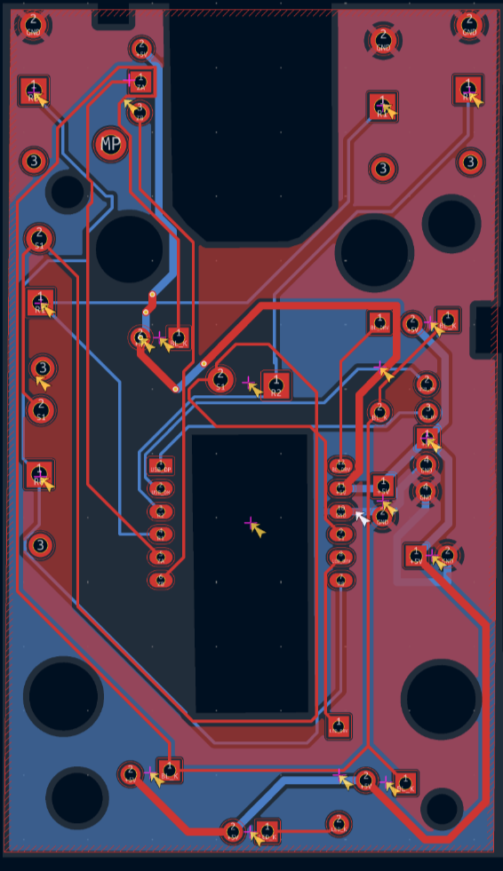

# Mouse PCB

Reverse-engineering the PCB of an optical mouse by tearing down wired single-chip and wireless dual-chip mice.
The circuit is traced using continuity measurements, then recreated in KiCad as a schematic, custom symbols/footprints, and a PCB layout.
Gerber files for the V1 board are generated and included in `gerbers/`.

